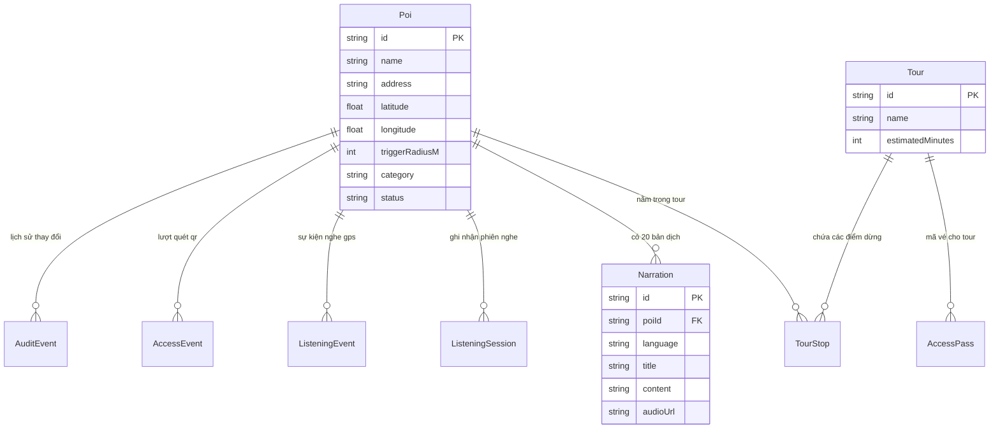
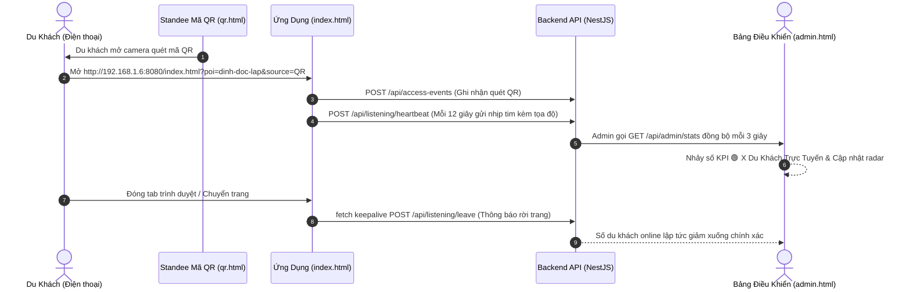
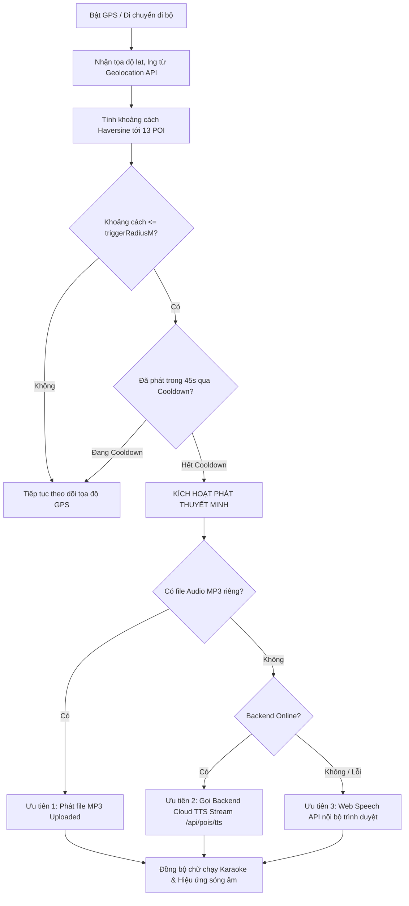
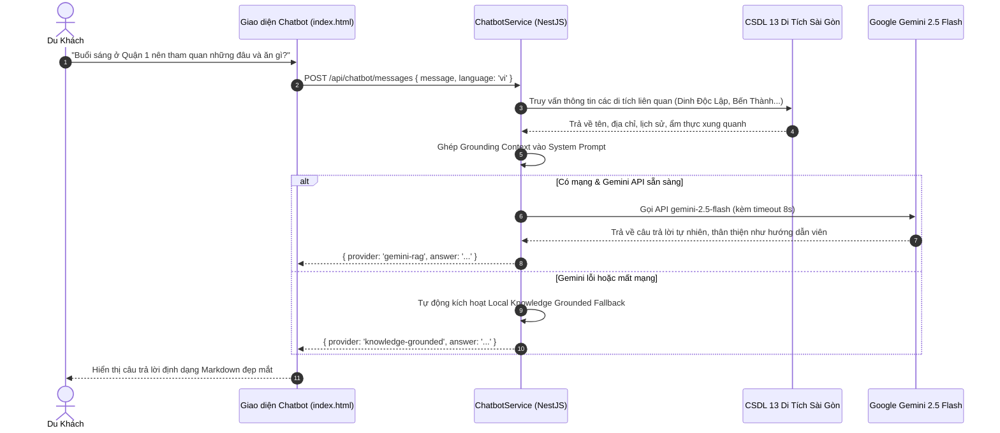

# 📖 CẨM NANG HƯỚNG DẪN DỰ ÁN SÀI GÒN DI SẢN (GEOAUDIO GUIDE)
> **Tài liệu Onboarding & Kiến trúc Hệ thống dành cho Thành viên mới & Bảo vệ Đồ án**  
> *Phiên bản: 2.0 • Kiến trúc: 3-Tier Enterprise • CSDL: PostgreSQL/PostGIS • Nền tảng: NestJS + Vanilla JS PWA*

---

## 📑 MỤC LỤC
1. [Tổng Quan Dự Án & Bài Toán Nghiệp Vụ](#1-tổng-quan-dự-án--bài-toán-nghiệp-vụ)
2. [Bảng Công Nghệ Sử Dụng & Lý Do Lựa Chọn (Tech Stack)](#2-bảng-công-nghệ-sử-dụng--lý-do-lựa-chọn-tech-stack)
3. [Sơ Đồ Cấu Trúc Thư Mục Chi Tiết (Directory Tree)](#3-sơ-đồ-cấu-trúc-thư-mục-chi-tiết-directory-tree)
4. [Giải Thích Cấu Trúc Database (`schema.prisma`)](#4-giải-thích-cấu-trúc-database-schemaprisma)
5. [Giải Thích Chi Tiết 4 Luồng Hoạt Động Cốt Lõi (Core Workflows)](#5-giải-thích-chi-tiết-4-luồng-hoạt-động-cốt-lõi-core-workflows)
6. [Hướng Dẫn Cài Đặt, Kết Nối Điện Thoại & Kiểm Thử (Cheat Sheet)](#6-hướng-dẫn-cài-đặt-kết-nối-điện-thoại--kiểm-thử-cheat-sheet)
7. [Cẩm Nang Trả Lời Phản Biện Đồ Án (FAQ Cho Hội Đồng)](#7-cẩm-nang-trả-lời-phản-biện-đồ-án-faq-cho-hội-đồng)

---

## 1. TỔNG QUAN DỰ ÁN & BÀI TOÁN NGHIỆP VỤ

### 1.1. Bài toán thực tế
Khi khách du lịch trong nước và quốc tế đến tham quan TP. Hồ Chí Minh, họ thường gặp các rào cản lớn:
- **Thiếu thuyết minh viên đa ngữ**: Rất khó để tìm được hướng dẫn viên nói thành thạo các tiếng hiếm (Lào, Khmer, Philippines, Ả Rập, Bồ Đào Nha, Ba Lan...).
- **Rào cản tải App**: Các ứng dụng du lịch truyền thống yêu cầu tải qua App Store / Google Play dung lượng hàng trăm MB, bắt đăng ký tài khoản rườm rà khiến hơn **75% du khách từ bỏ**.
- **Trải nghiệm nghe thủ công**: Du khách phải tự bấm chọn điểm nghe thay vì được phục vụ tự động theo vị trí bước chân thực tế.

### 1.2. Giải pháp của dự án Sài Gòn Di Sản
Hệ thống là một **Progressive Web Application (PWA)** siêu nhẹ, khởi chạy tức thì trên mọi trình duyệt điện thoại (iOS Safari, Android Chrome) mà **không cần cài đặt ứng dụng**:
- 📍 **Định vị GPS & Geofencing**: Tự động phát hiện khi du khách bước vào bán kính của 13 điểm di tích lịch sử nổi tiếng tại Quận 1 - Quận 3 - Quận 4 TP.HCM và tự động phát thuyết minh.
- 📱 **Quét mã QR tại Standee / Kiosk**: Du khách chỉ cần mở camera điện thoại quét mã QR là mở ngay bài thuyết minh của di tích đó.
- 🌐 **Hỗ trợ 20 ngôn ngữ quốc tế**: 260 bản thuyết minh được chuẩn hóa cho đủ 20 ngôn ngữ: Tiếng Việt, Anh, Pháp, Nhật, Hàn, Trung (Giản thể & Phồn thể), Thái, Lào, Khmer, Indonesia, Malaysia, Philippines, Hindi, Ả Rập, Nga, Bồ Đào Nha, Ý, Đức, Tây Ban Nha.
- 🤖 **Chatbot Hướng dẫn viên AI (Hybrid RAG)**: Trả lời thông minh mọi câu hỏi lịch sử, lộ trình, ẩm thực theo ngữ cảnh thực tế của 13 di tích bằng Google Gemini 2.5 Flash.

### 1.3. Vai trò của 3 giao diện người dùng (Frontends)
```
+-----------------------------------------------------------------------------------+
|                                 HỆ THỐNG SÀI GÒN DI SẢN                            |
+--------------------------+------------------------------+-------------------------+
|   📱 demo/index.html     |       🖨️ demo/qr.html        |    📊 demo/admin.html   |
|   (Dành cho Du khách)    |   (Standee / Kiosk In ấn)    |  (Dành cho Quản trị)    |
+--------------------------+------------------------------+-------------------------+
| • Bản đồ Leaflet vệ tinh | • Tạo mã QR chất lượng cao   | • Giám sát du khách     |
| • Geofence radar ảo      | • Tự nhận diện IP Wi-Fi LAN  |   trực tiếp (Heartbeat) |
| • Karaoke kịch bản đồng bộ| • Preview URL thực tế       | • CRUD 13 địa điểm POI  |
| • Chatbot Hướng dẫn viên | • In Standee A4 chuẩn        | • Upload Audio MP3      |
| • 3 Tour chuyên gia gợi ý| • Tải ảnh PNG mã QR          | • Xuất CSV Audit Logs   |
+--------------------------+------------------------------+-------------------------+
```

---

## 2. BẢNG CÔNG NGHỆ SỬ DỤNG & LÝ DO LỰA CHỌN (TECH STACK)

| Công nghệ | Thành phần | Vai trò trong dự án | Lý do lựa chọn (Ưu điểm vượt trội) |
| :--- | :--- | :--- | :--- |
| **NestJS 10** | Backend Framework | Nền tảng xây dựng RESTful API theo kiến trúc **3-Tier** | Module hóa chặt chẽ, Dependency Injection mạnh mẽ, chuẩn hóa cấu trúc doanh nghiệp, dễ viết Unit Test. |
| **PostgreSQL 16** | Database | Hệ quản trị cơ sở dữ liệu quan hệ chính | Bền vững ACID, hỗ trợ JSONB, hiệu năng cao và mở rộng module địa lý tối ưu nhất hiện nay. |
| **PostGIS Extension** | GIS Engine | Xử lý dữ liệu không gian địa lý trên CSDL | Cho phép dùng hàm `ST_DWithin` và `ST_DistanceSphere` tính toán khoảng cách cầu theo tọa độ GPS với chỉ mục GiST $O(\log N)$. |
| **Prisma 7 ORM** | Data Access Layer | Giao tiếp giữa NestJS Service/Repository với PostgreSQL | Type-safe 100%, tự động sinh migration SQL, tự động kiểm tra cú pháp tại compile-time, chống SQL Injection tuyệt đối. |
| **Google Gemini API** | AI Engine | Chatbot Hướng Dẫn Viên Du Lịch Thông Minh | Model `gemini-2.5-flash` tốc độ phản hồi cực nhanh (< 1.5s), hỗ trợ cơ chế Hybrid RAG grounding thông tin 13 di tích. |
| **TTS Proxy Stream** | Audio Engine | Chuyển văn bản thành giọng nói mượt mà 20 thứ tiếng | Gọi luồng âm thanh Google Cloud TTS qua `/api/pois/tts`, tự động tách câu $\le 175$ ký tự và ghép các buffer MP3 nhị phân. |
| **Web Speech API** | Audio Fallback | Giọng đọc nội bộ của trình duyệt | Hoạt động ngay cả khi ngoại tuyến/mất mạng, tự động lọc giọng theo từng ngôn ngữ và ưu tiên giọng *Natural / Online*. |
| **Leaflet.js 1.9.4** | Frontend Map | Bản đồ tương tác vệ tinh & vòng hào quang Geofence | Nhẹ (chỉ ~40KB), mã nguồn mở, không tốn phí bản quyền Google Maps API đắt đỏ, chạy mượt mà trên mobile. |
| **Nginx Alpine** | Reverse Proxy | Cổng ngõ Web tĩnh và điều phối API | Gom chung cổng `8080` cho cả Static HTML và REST API `/api/`, giúp điện thoại LAN kết nối duy nhất 1 cổng qua Firewall. |
| **Docker Compose** | DevOps / Deployment| Đóng gói trọn gói 3 containers: `db`, `api`, `web` | Triển khai 1 lệnh duy nhất là chạy đủ hệ sinh thái, đồng nhất môi trường giữa máy dev và server thật. |
| **Vitest** | Unit Testing | Bộ khung chạy kiểm thử tự động | Chạy siêu nhanh, hỗ trợ ESM/TypeScript trực tiếp mà không cần cấu hình Babel hay ts-jest rườm rà. |
| **Oxlint** | Linter | Rà soát lỗi cú pháp mã nguồn | Viết bằng Rust, tốc độ quét nhanh gấp 50-100 lần ESLint, đảm bảo 0 warning, 0 error. |

---

## 3. SƠ ĐỒ CẤU TRÚC THƯ MỤC CHI TIẾT (DIRECTORY TREE)

```text
D:\1_eda\DA_CNPM
├── .env                              # Biến môi trường gốc (DB, PORT, IP Wi-Fi, Gemini Key)
├── .env.example                      # File mẫu biến môi trường chuẩn để onboarding
├── docker-compose.yml                # Cấu hình 3 containers Docker (PostGIS DB, NestJS API, Nginx Web)
├── huongdan.md                       # Cẩm nang kiến trúc & hướng dẫn toàn diện (file này)
├── README.md                         # Giới thiệu tổng quan dự án bằng tiếng Anh & tiếng Việt
│
├── backend/                          # Mã nguồn Backend NestJS (Kiến trúc 3-Tier)
│   ├── .env                          # Biến môi trường cục bộ của Backend
│   ├── package.json                  # Dependencies (NestJS, Prisma, Vitest, Oxlint)
│   ├── tsconfig.json                 # Cấu hình TypeScript compile
│   ├── Dockerfile                    # Multi-stage Docker build cho Backend Node 22 Alpine
│   │
│   ├── prisma/                       # Cấu hình CSDL Prisma & Dữ liệu Seed
│   │   ├── schema.prisma             # Định nghĩa 11 bảng dữ liệu & quan hệ khóa ngoại
│   │   ├── seed.ts                   # Script nạp 13 POI Sài Gòn, 260 thuyết minh, 3 Tour
│   │   └── migrations/               # Lịch sử các file SQL Migration tự động
│   │
│   ├── src/                          # Mã nguồn chính theo mô hình 3 Tầng (3-Tier)
│   │   ├── main.ts                   # Điểm khởi động ứng dụng NestJS (Bootstrap, Port 3000)
│   │   ├── app.module.ts             # Module gốc liên kết tất cả 10 feature modules
│   │   ├── app.setup.ts              # Cấu hình Middleware, CORS, Static Demo Assets, Validation
│   │   ├── app.controller.ts         # Endpoint /health và /api/system/network-info
│   │   │
│   │   ├── poi/                      # MODULE QUẢN LÝ POI & TTS PROXY (UC1, UC2)
│   │   │   ├── poi.controller.ts     # [Presentation] GET /api/pois, GET /api/pois/tts, GET /nearby
│   │   │   ├── poi.service.ts        # [Business Logic] Lọc trigger Geofence, Ghép nối Google TTS
│   │   │   ├── poi.repository.ts     # [Data Access] Truy vấn CSDL Prisma bảng Poi & Narration
│   │   │   ├── poi.module.ts         # Khai báo DI Module
│   │   │   └── dto.ts                # Data Transfer Objects & Validation
│   │   │
│   │   ├── chatbot/                  # MODULE AI CHATBOT RAG (UC4)
│   │   │   ├── chatbot.controller.ts # [Presentation] POST /api/chatbot/messages
│   │   │   ├── chatbot.service.ts    # [Business Logic] RAG Grounding 13 POI + Xoay vòng Gemini
│   │   │   ├── chatbot.repository.ts # [Data Access] Tìm kiếm POI liên quan theo từ khóa
│   │   │   └── chatbot.module.ts     # Khai báo DI Module
│   │   │
│   │   ├── admin/                    # MODULE QUẢN TRỊ VIÊN & AUDIT LOGS (UC3, UC7, UC8)
│   │   │   ├── admin.controller.ts   # [Presentation] CRUD POI, Upload Audio, Lấy KPI & Audit
│   │   │   ├── admin.service.ts      # [Business Logic] Quy tắc nghiệp vụ Admin & Ghi Audit
│   │   │   ├── admin.repository.ts   # [Data Access] Thống kê Dashboard KPI & Lịch sử kiểm toán
│   │   │   └── admin.module.ts       # Khai báo DI Module
│   │   │
│   │   ├── listening/                # MODULE PHIÊN NGHE & THỐNG KÊ (UC2)
│   │   │   ├── listening.controller.ts # [Presentation] Bắt đầu/Kết thúc phiên nghe, Heartbeat
│   │   │   ├── listening.service.ts  # [Business Logic] Chống trùng lặp 5s, tính thời lượng nghe
│   │   │   ├── listening.repository.ts# [Data Access] Ghi nhận ListeningSession & ListeningEvent
│   │   │   └── listening.module.ts   # Khai báo DI Module
│   │   │
│   │   ├── tour/                     # MODULE LỘ TRÌNH TOUR GỢI Ý (UC6)
│   │   │   ├── tour.controller.ts    # [Presentation] GET /api/tours/suggested
│   │   │   ├── tour.service.ts       # [Business Logic] Sắp xếp lộ trình, tính thời gian đi bộ
│   │   │   ├── tour.repository.ts    # [Data Access] Lấy Tour và danh sách TourStop
│   │   │   └── tour.module.ts        # Khai báo DI Module
│   │   │
│   │   ├── translation/              # MODULE ĐA NGÔN NGỮ (20 THỨ TIẾNG)
│   │   │   ├── translation.controller.ts # [Presentation] GET /api/languages, GET /narrations
│   │   │   ├── translation.service.ts# [Business Logic] Danh mục 20 ngôn ngữ chuẩn ISO
│   │   │   ├── translation.repository.ts # [Data Access] Lấy danh mục ngôn ngữ từ CSDL
│   │   │   └── translation.module.ts # Khai báo DI Module
│   │   │
│   │   ├── geo/                      # MODULE TÍNH TOÁN KHOẢNG CÁCH KHÔNG GIAN
│   │   ├── access-pass/              # MODULE MÃ VÉ QUÉT QR (UC5)
│   │   ├── access-event/             # MODULE THEO DÕI LƯỢT TRUY CẬP DU KHÁCH
│   │   ├── auth/                     # BẢO MẬT API KEY & QUYỀN ADMIN (AdminKeyGuard)
│   │   ├── config/                   # Đọc biến môi trường an toàn Type-safe
│   │   └── database/                 # PrismaService kết nối PostgreSQL & kích hoạt PostGIS
│   │
│   ├── test/                         # 9 bộ kiểm thử tự động (Unit Test Suites)
│   │   ├── admin.service.spec.ts     # Test CRUD POI, Audit Event, KPI Admin
│   │   ├── chatbot.service.spec.ts   # Test Gemini RAG, Xoay vòng Model, Fallback nội bộ
│   │   ├── geo-nearby.service.spec.ts# Test Geofence trigger, Cooldown, Reset bán kính, TTS Proxy
│   │   ├── listening.service.spec.ts # Test Phiên nghe, Chống trùng lặp sự kiện nghe
│   │   ├── tour.service.spec.ts      # Test Tour gợi ý và thứ tự điểm dừng
│   │   ├── translation.service.spec.ts # Test 20 ngôn ngữ và fallback mã ngôn ngữ
│   │   ├── access-pass.service.spec.ts # Test Mã vé QR, hạn dùng 72 giờ
│   │   ├── app.controller.spec.ts    # Test Healthcheck và Lọc IP Mạng LAN
│   │   └── rate-limit.guard.spec.ts  # Test Giới hạn tần suất gọi API
│   │
│   └── uploads/                      # Thư mục chứa các file âm thanh MP3 do Admin tải lên
│
└── demo/                             # Giao diện người dùng Web tĩnh (PWA Frontend)
    ├── index.html                    # Ứng dụng Du khách (Bản đồ, Geofence, Audio, Chatbot, Tour)
    ├── admin.html                    # Bảng điều khiển Quản trị viên (Dashboard, Radar, CRUD, QR Studio)
    ├── qr.html                       # Trang Standee in ấn mã QR tự động nhận diện IP LAN
    ├── api-client.js                 # Thư viện Adapter kết nối API, chuẩn hóa 20 thứ tiếng
    ├── nginx.conf                    # Cấu hình máy chủ Nginx reverse-proxy cổng 8080
    └── test-api-client.js            # Script kiểm thử độc lập cho api-client.js
```

---

## 4. GIẢI THÍCH CẤU TRÚC DATABASE (`schema.prisma`)

CSDL được thiết kế chuẩn hóa quan hệ (RDBMS), tuân thủ nguyên tắc toàn vẹn dữ liệu:



### Chi tiết ý nghĩa các bảng dữ liệu:
1. **`Poi` (Point of Interest)**: Lưu trữ 13 địa điểm di tích Sài Gòn với tọa độ GPS (`latitude`, `longitude`), bán kính kích hoạt tự động (`triggerRadiusM`, mặc định 80m), bán kính reset phát lại (`resetRadiusM = 1.5 * triggerRadiusM`), danh mục (`category`), trạng thái (`ACTIVE` / `INACTIVE`).
2. **`Narration` (Bản thuyết minh)**: Lưu trữ nội dung thuyết minh văn bản và URL file MP3. Có quan hệ 1-N với `Poi`. Ràng buộc `@@unique([poiId, language])` đảm bảo mỗi POI chỉ có đúng 1 bản thuyết minh cho 1 ngôn ngữ. Hỗ trợ đủ 20 ngôn ngữ.
3. **`LanguageCatalog`**: Danh mục 20 ngôn ngữ chính thức của hệ thống với mã chuẩn ISO (`vi`, `en`, `fr`, `ja`, `zh`, `zh_TW`, `ko`, `th`, `lo`, `km`, `id`, `ms`, `fil`, `hi`, `ar`, `ru`, `pt`, `it`, `de`, `es`), tên bản địa, cờ quốc gia và thứ tự sắp xếp.
4. **`Tour` & `TourStop`**: Quản lý 3 tour gợi ý từ chuyên gia. `TourStop` liên kết POI vào Tour theo số thứ tự `position` tăng dần, lưu thời gian đi bộ dự kiến giữa các chặng.
5. **`VisitorSession` & `ListeningSession`**: Quản lý phiên truy cập của du khách theo `visitorId`, thời gian bắt đầu, kết thúc, thời lượng nghe thực tế (`durationSeconds`) và trạng thái (`PLAYING`, `COMPLETED`, `ABORTED`).
6. **`ListeningEvent`**: Nhật ký chi tiết mỗi lần du khách nghe thuyết minh (nghe tự động qua Geofence hay bấm tay thủ công, tọa độ GPS thực tế lúc nghe).
7. **`AccessEvent`**: Ghi nhận du khách vào hệ thống từ nguồn nào (`QR`, `DIRECT`, `SEARCH`), địa điểm di tích nào và ngôn ngữ đang chọn.
8. **`AuditEvent`**: Nhật ký kiểm toán toàn bộ thao tác của Quản trị viên (thêm POI mới, cập nhật tọa độ, bật/tắt trạng thái, xóa địa điểm, upload audio) phục vụ báo cáo và xuất file CSV.
9. **`AccessPass`**: Quản lý mã vé tham quan (vé theo Tour hoặc vé VIP), có thời hạn hết hạn (`expiresAt` sau 72 giờ).

> [!IMPORTANT]
> **Ý nghĩa của quy tắc khóa ngoại `onDelete: Restrict`**:  
> Toàn bộ quan hệ giữa `Poi` với `ListeningSession`, `ListeningEvent`, `AuditEvent` đều sử dụng `onDelete: Restrict` thay vì `Cascade`. Điều này ngăn chặn việc Admin lỡ tay xóa một POI làm mất sạch dữ liệu lịch sử nghe, thống kê KPI và nhật ký kiểm toán trong quá khứ. Muốn xóa POI, Admin phải chủ động chuyển trạng thái sang `INACTIVE` (Soft Delete) hoặc xử lý dữ liệu con trước.

---

## 5. GIẢI THÍCH CHI TIẾT 4 LUỒNG HOẠT ĐỘNG CỐT LÕI (CORE WORKFLOWS)

### 5.1. Luồng 1: Du khách quét mã QR & Giám sát trực tuyến theo thời gian thực (Presence Telemetry)



- **Bước 1**: Du khách quét mã QR trên standee tại di tích.
- **Bước 2**: Trình duyệt mở `index.html` kèm tham số `?poi=dinh-doc-lap&source=QR`.
- **Bước 3**: Ứng dụng tự động gửi `recordAccessEvent` về máy chủ.
- **Bước 4**: Một bộ đếm nhịp tim chạy ngầm mỗi 12 giây (`sendHeartbeat`) gửi định danh du khách `visitorId`, địa điểm hiện tại và tọa độ GPS về Backend.
- **Bước 5**: Màn hình `admin.html` đồng bộ dữ liệu mỗi 3 giây, hiển thị chấm xanh phát xung trên bản đồ Radar và nhảy số thẻ **🟢 X du khách trực tuyến**.
- **Bước 6**: Khi du khách đóng tab hoặc khóa máy, sự kiện `pagehide` và `beforeunload` kích hoạt `fetch` với cờ `keepalive: true` gọi endpoint `/api/listening/leave`, máy chủ xóa ngay phiên hoạt động giúp số du khách online giảm lập tức mà không bị đọng rác.

---

### 5.2. Luồng 2: Định vị GPS & Kích hoạt Geofence tự động phát âm thanh đa tầng



- **Tính toán khoảng cách Geofence**:  
  Ứng dụng tính khoảng cách đường tròn lớn giữa tọa độ du khách $(lat_1, lng_1)$ và tọa độ di tích $(lat_2, lng_2)$ bằng công thức **Haversine**:
  $$d = 2R \cdot \arcsin\left(\sqrt{\sin^2\left(\frac{\Delta lat}{2}\right) + \cos(lat_1)\cos(lat_2)\sin^2\left(\frac{\Delta lng}{2}\right)}\right)$$
- **Thứ tự ưu tiên phát âm thanh thông minh (Audio Fallback Hierarchy)**:
  1. **Ưu tiên 1**: File âm thanh MP3 chất lượng cao do Admin thu âm và tải lên cho địa điểm đó.
  2. **Ưu tiên 2**: Nếu chưa có file thu âm, tự động gọi **Backend Cloud TTS Proxy** (`GET /api/pois/tts?lang=...&text=...`), Google Translate TTS sẽ chuyển hóa văn bản thành luồng MP3 mượt mà cho toàn bộ 20 thứ tiếng.
  3. **Ưu tiên 3**: Nếu mất mạng hoặc Backend bận, hệ thống tự động fallback tức thì về **Web Speech API** cài sẵn trong điện thoại, tự động chọn giọng đọc tốt nhất (*Natural / Google Voice*).
- **Karaoke kịch bản đồng bộ**:  
  Văn bản thuyết minh được chia thành từng câu hoàn chỉnh. Khi âm thanh chạy đến đâu, câu tương ứng sẽ được tô sáng màu vàng đồng và tự động cuộn đến mắt người đọc. Nếu người dùng tự tay kéo màn hình đọc trước, hệ thống tự động ngưng cuộn tự động trong 6 giây để không gây giật màn hình.

---

### 5.3. Luồng 3: Chatbot Hướng Dẫn Viên AI Hybrid RAG



- **Cơ chế Hybrid RAG (Retrieval-Augmented Generation)**:
  - Khi du khách hỏi, hệ thống **không** gửi câu hỏi trơ trọi cho AI.
  - `ChatbotService` quét qua cơ sở dữ liệu 13 di tích Sài Gòn, tìm ra các điểm liên quan nhất đến câu hỏi (theo tên, quận, loại hình, ẩm thực).
  - Đóng gói dữ liệu di tích chính xác này thành **Ngữ cảnh tin cậy (Grounding Knowledge)** gửi kèm câu hỏi cho Gemini. Nhờ đó, AI trả lời chuẩn xác 100% về giờ mở cửa, địa chỉ, sự kiện lịch sử Sài Gòn, triệt tiêu hoàn toàn hiện tượng "ảo giác" (hallucination).
- **Cơ chế xoay vòng Model (Model Rotation) & Fallback 3 lớp**:
  - Hệ thống tự động xoay vòng qua danh sách model: `gemini-2.5-flash` $\rightarrow$ `gemini-3.1-flash-lite` $\rightarrow$ `gemini-3.8-flash` $\rightarrow$ `gemini-flash-latest`.
  - Nếu tất cả model đều bị nghẽn mạng hoặc hết hạn mức, `ChatbotService` tự động chuyển sang lớp **Local Knowledge-Grounded Fallback**, tổng hợp câu trả lời từ dữ liệu nội bộ trong CSDL và gửi về cho du khách, đảm bảo dịch vụ không bao giờ bị "chết".

---

### 5.4. Luồng 4: Quản trị viên CRUD Địa Điểm, Upload Audio & Nhật Ký Kiểm Toán (Audit Logs)

- **Bảo vệ bằng khóa quản trị (`x-admin-key`)**: Mọi endpoint quản trị trong `AdminController` đều được chặn và kiểm tra bởi `AdminKeyGuard`. Request không có header `x-admin-key` hợp lệ sẽ bị từ chối `401 Unauthorized`.
- **Upload File Âm Thanh Thuyết Minh**:
  - Endpoint `POST /api/admin/upload-audio` hoặc `POST /api/admin/pois/:id/audio` nhận file nhị phân qua `multipart/form-data`.
  - Kiểm tra định dạng nghiêm ngặt: Chỉ chấp nhận audio (`.mp3`, `.wav`, `.ogg`, `.m4a`), giới hạn dung lượng $\le 15\text{MB}$.
  - File được lưu vào thư mục `backend/uploads/` và đường dẫn tĩnh `/uploads/...` được cập nhật tự động vào bảng `Narration` theo đúng mã ngôn ngữ.
- **Nhật ký kiểm toán tự động (Audit Trail) & Xuất CSV**:
  - Mọi thao tác `CREATE_POI`, `UPDATE_POI`, `TOGGLE_POI_STATUS`, `DELETE_POI`, `UPLOAD_AUDIO` đều tự động ghi một bản ghi vào bảng `AuditEvent` gồm: Thời gian thực, hành động, loại thực thể, mã thực thể, người thực hiện và dữ liệu thay đổi.
  - Trên màn hình `admin.html`, Quản trị viên có thể xem bảng nhật ký kiểm toán trực quan và bấm nút **📤 Xuất CSV Audit Logs** để tải file báo cáo về máy tính phục vụ thanh tra.

---

## 6. HƯỚNG DẪN CÀI ĐẶT, KẾT NỐI ĐIỆN THOẠI & KIỂM THỬ (CHEAT SHEET)

### 6.1. Chạy nhanh toàn bộ bằng Docker (Khuyên dùng)
Chỉ cần cài đặt [Docker Desktop](https://www.docker.com/products/docker-desktop/) và chạy lệnh sau tại thư mục gốc:

```powershell
# Khởi động toàn bộ CSDL PostGIS, Backend NestJS và Web Nginx
docker compose up -d --build
```
Sau khi chạy xong:
- 📱 Ứng dụng Du khách: `http://localhost:8080/index.html` (hoặc `http://localhost:3000/index.html`)
- 🖨️ Kiosk In Standee QR: `http://localhost:8080/qr.html`
- 📊 Quản trị viên Admin: `http://localhost:8080/admin.html` (Admin Key: `local-admin-key-change-me`)
- 📚 Tài liệu Swagger API: `http://localhost:3000/docs`

---

### 6.2. Chạy trực tiếp trên máy không dùng Docker (Development Mode)

```powershell
# Bước 1: Di chuyển vào thư mục backend và cài đặt thư viện
cd backend
npm install

# Bước 2: Sinh mã Prisma Client và chạy migration
npx prisma generate
npx prisma migrate deploy

# Bước 3: Nạp 13 POI Sài Gòn, 260 thuyết minh và 3 Tour vào CSDL
npx tsx prisma/seed.ts

# Bước 4: Khởi chạy máy chủ Backend ở chế độ Watch
npm run start:dev
```

---

### 6.3. Hướng dẫn kết nối Điện Thoại Thật qua Wi-Fi LAN

1. **Xem IP Wi-Fi của máy tính**:
   Mở PowerShell gõ `ipconfig`, tìm dòng IPv4 của card Wi-Fi (ví dụ: `192.168.1.6`).
2. **Cấu hình biến môi trường**:
   Mở file `.env` ở thư mục gốc và đảm bảo có dòng:
   ```env
   SERVER_LAN_IP="192.168.1.6"
   ```
3. **Mở tường lửa Windows (Firewall)**:
   Để điện thoại có thể truy cập vào máy tính qua Wi-Fi, chạy lệnh PowerShell sau với quyền Administrator:
   ```powershell
   New-NetFirewallRule -DisplayName "Saigon Heritage Web" -Direction Inbound -LocalPort 8080,3000 -Protocol TCP -Action Allow
   ```
4. **Trải nghiệm trên điện thoại**:
   - Kết nối điện thoại vào **cùng mạng Wi-Fi** với máy tính.
   - Mở trình duyệt trên điện thoại gõ: `http://192.168.1.6:8080/index.html`.
   - Hoặc mở trang `http://localhost:8080/qr.html` trên máy tính và dùng điện thoại quét mã QR hiển thị trên màn hình.

---

### 6.4. Hướng dẫn chạy HTTPS Tunnel (Để bật GPS chuẩn xác trên Chrome/Safari)
Trình duyệt di động yêu cầu kết nối an toàn **HTTPS** để cấp quyền định vị GPS độ chính xác cao. Bạn có thể dùng Cloudflare Tunnel miễn phí không cần mở cổng modem:

```powershell
# Tải cloudflared và chạy lệnh tạo đường hầm HTTPS
cloudflared tunnel --url http://localhost:8080
```
Terminal sẽ cung cấp một đường link dạng `https://xxxx.trycloudflare.com`. Du khách ở bất kỳ đâu chỉ cần mở link này là có đầy đủ HTTPS, GPS định vị vệ tinh và nghe thuyết minh mượt mà 100%.

---

### 6.5. Lệnh chạy Kiểm Thử & Kiểm Tra Mã Nguồn

```powershell
# 1. Chạy 61 Unit Tests (Vitest)
npm test --prefix backend

# 2. Kiểm tra chất lượng mã nguồn (Oxlint - 0 warning, 0 error)
npm run lint --prefix backend

# 3. Build kiểm tra biên dịch TypeScript
npm run build --prefix backend

# 4. Chạy kiểm thử độc lập cho api-client.js
node demo/test-api-client.js
```

---

## 7. CẨM NANG TRẢ LỜI PHẢN BIỆN ĐỒ ÁN (FAQ CHO HỘI ĐỒNG)

Dưới đây là 6 câu hỏi kinh điển nhất mà các thầy cô trong Hội đồng phản biện thường đặt ra và gợi ý câu trả lời chuẩn xác, tự tin:

### ❓ Câu 1: Tại sao nhóm không viết Mobile App bằng Flutter hay React Native mà lại chọn Web App (PWA)?
> **Trả lời**:  
> "Dạ thưa Thầy/Cô, đối với nghiệp vụ thuyết minh du lịch tại điểm, **rào cản lớn nhất của du khách là sự ngại ngùng khi phải tải ứng dụng**. Một du khách quốc tế vừa bước đến cổng Dinh Độc Lập sẽ không muốn đứng đợi 10 phút để tải một ứng dụng 200MB trên App Store, đăng ký tài khoản rồi mới được nghe.  
> Nhóm chọn giải pháp **Progressive Web App (PWA)** kết hợp mã QR: Du khách chỉ cần mở camera điện thoại quét mã là bài thuyết minh lập tức phát trong vòng **1 giây**. Giải pháp này tối ưu hóa tối đa tỷ lệ tiếp cận khách hàng (Conversion Rate) và tương thích ngay lập tức trên 100% dòng máy Android lẫn iOS."

---

### ❓ Câu 2: Thuật toán Geofencing định vị du khách hoạt động thế nào? Sự khác biệt giữa tính toán bằng code và dùng PostGIS trên CSDL?
> **Trả lời**:  
> "Dạ thưa Thầy/Cô, hệ thống áp dụng cơ chế định vị không gian 2 lớp:  
> - **Tại Frontend**: Dùng công thức lượng giác cầu **Haversine** để tính toán khoảng cách liên tục ngay trên trình duyệt mà không cần spam request lên server, giúp tiết kiệm pin điện thoại và giảm tải cho máy chủ.  
> - **Tại Backend**: Sử dụng extension **PostGIS** của PostgreSQL với hàm `ST_DWithin` và kiểu hình học `GEOGRAPHY(Point, 4326)`. PostGIS sử dụng chỉ mục không gian **R-Tree / GiST Index**, giúp truy vấn các điểm di tích trong bán kính $R$ đạt độ phức tạp $O(\log N)$ thay vì quét tuần tự $O(N)$. Điều này đảm bảo hệ thống có thể phục vụ hàng chục ngàn du khách đồng thời mà không bị nghẽn CSDL."

---

### ❓ Câu 3: Làm thế nào hệ thống đảm bảo du khách vẫn nghe được thuyết minh khi đi vào vùng mất sóng 4G hoặc khi API Gemini gặp sự cố?
> **Trả lời**:  
> "Dạ thưa Thầy/Cô, hệ thống được thiết kế theo nguyên lý **Graceful Degradation (Suy thoái mượt mà)**:  
> - **Về âm thanh thuyết minh (3 tầng dự phòng)**: Hệ thống ưu tiên file MP3 thu âm $\rightarrow$ nếu không có thì gọi Backend Cloud TTS Proxy $\rightarrow$ nếu mất mạng hoàn toàn, hệ thống tự động kích hoạt **Web Speech API** chạy trực tiếp bằng bộ tổng hợp giọng nói phần cứng của điện thoại, do đó du khách vẫn nghe thuyết minh bình thường kể cả khi mất sóng.  
> - **Về Chatbot AI**: Nếu API Gemini bị quá tải hoặc mất kết nối, `ChatbotService` tự động bắt lỗi và chuyển sang tầng **Local Knowledge Grounded Fallback**, tổng hợp câu trả lời từ dữ liệu 13 di tích lưu sẵn trong CSDL nội bộ để phục vụ du khách ngay lập tức mà không báo lỗi sập hệ thống."

---

### ❓ Câu 4: Cơ chế hiển thị số du khách trực tuyến (Active Visitors) trên màn hình Admin hoạt động thế nào khi nhóm không dùng WebSocket?
> **Trả lời**:  
> "Dạ thưa Thầy/Cô, để hệ thống gọn nhẹ và tiết kiệm tài nguyên máy chủ, nhóm sử dụng kỹ thuật **HTTP Heartbeat Telemetry kết hợp Polling có cửa sổ trượt (Sliding Window)**:  
> - Mỗi điện thoại du khách gửi một tín hiệu nhịp tim định kỳ mỗi 12 giây (`/api/listening/heartbeat`).  
> - Phía Admin Dashboard gọi thống kê mỗi 3 giây. CSDL đếm số lượng `visitorId` duy nhất có phát sinh nhịp tim trong vòng 45 giây gần nhất.  
> - Khi du khách đóng tab hoặc rời khỏi trang, sự kiện `pagehide` kích hoạt `fetch` với cờ `keepalive: true` gửi lệnh `/api/listening/leave`, giúp máy chủ xóa phiên truy cập ngay lập tức. Giải pháp này giúp số liệu hiển thị tức thì, không bị sai lệch mà không cần duy trì hàng ngàn kết nối WebSocket dạng State-full tốn bộ nhớ RAM."

---

### ❓ Câu 5: Tại sao Backend lại tách thành 3 tầng (Controller - Service - Repository) thay vì viết chung trong Service như các dự án mẫu NestJS thông thường?
> **Trả lời**:  
> "Dạ thưa Thầy/Cô, nhóm áp dụng triệt để nguyên lý **Separation of Concerns (Tách biệt mối quan tâm)** và chuẩn kiến trúc doanh nghiệp:  
> - **Tầng Controller**: Chỉ chịu trách nhiệm giao tiếp HTTP, validate tham số đầu vào (`DTO`), định tuyến API và phân quyền (`Guard`).  
> - **Tầng Service**: Nơi chứa toàn bộ luật nghiệp vụ (Business Rules), thuật toán Geofence cooldown, thuật toán RAG Chatbot, logic ghép nối âm thanh TTS. Tầng này hoàn toàn độc lập với nguồn dữ liệu.  
> - **Tầng Repository**: Đóng gói các câu truy vấn Prisma và PostGIS.  
> Lợi ích lớn nhất là nhóm có thể viết **Unit Test độc lập 100%** (Mock tầng Repository để test tầng Service) mà không cần phải kết nối CSDL thật, giúp hệ thống đạt độ tin cậy tuyệt đối với 61/61 bài test chạy tự động trong chưa đầy 2 giây."

---

### ❓ Câu 6: Dữ liệu đa ngôn ngữ được lưu trữ và tối ưu hóa thế nào để phục vụ 20 thứ tiếng cùng lúc mà không làm phình to bảng dữ liệu?
> **Trả lời**:  
> "Dạ thưa Thầy/Cô, nhóm sử dụng mô hình quan hệ chuẩn hóa $1 - N$ giữa bảng `Poi` và bảng `Narration`:  
> - Thay vì thêm 20 cột cho 20 thứ tiếng vào cùng một bảng `Poi` (gây thưa thớt dữ liệu và khó mở rộng), nhóm tách thành bảng `Narration` riêng biệt với khóa ngoại `poiId` và cột `language`.  
> - Ràng buộc `@@unique([poiId, language])` đảm bảo tính toàn vẹn dữ liệu.  
> - Khi du khách chọn ngôn ngữ nào, hệ thống chỉ `JOIN` đúng bản thuyết minh của ngôn ngữ đó, kích thước payload trả về rất nhỏ (chỉ vài KB), giúp ứng dụng load nhanh trên mạng 3G/4G và cho phép ban quản trị bổ sung thêm ngôn ngữ thứ 21, 22 trong tương lai mà không cần phải sửa cấu trúc bảng `Poi` ban đầu."

---

*(Tài liệu được biên soạn đồng bộ 100% với mã nguồn dự án Sài Gòn Di Sản. Chúc các bạn bảo vệ đồ án thành công xuất sắc!)*
